<p align="center">
  <picture>
    <source media="(max-width: 600px) and (prefers-color-scheme: light)" srcset=".github/assets/banner-phone-light.svg">
    <source media="(max-width: 600px)" srcset=".github/assets/banner-phone.svg">
    <source media="(prefers-color-scheme: light)" srcset=".github/assets/banner-light.svg">
    
  </picture>
</p>

<div align="center">

[](https://github.com/ryanduguid/github-agent-skills/actions/workflows/validate.yml) [](https://codecov.io/gh/ryanduguid/github-agent-skills) [](https://github.com/ryanduguid/github-agent-skills/actions/workflows/github-code-scanning/codeql) [](https://sonarcloud.io/summary/new_code?id=ryanduguid_github-agent-skills) [](https://app.codacy.com/gh/ryanduguid/github-agent-skills/dashboard)<br> [](https://scorecard.dev/viewer/?uri=github.com/ryanduguid/github-agent-skills) [](https://www.bestpractices.dev/projects/15424)<br> [](https://github.com/ryanduguid/github-agent-skills/releases/latest) [](LICENSE)

</div>

Five focused, portable Agent Skills for evidence-based GitHub work. The
canonical source is `.claude/skills/`, which Claude Code reads in place; a
generated copy in `.agents/skills/` serves Codex.

## Skills

- `github-repository-audit`: assess a repository from inspected evidence.
- `github-readme-polish`: improve README clarity without unsupported claims.
- `github-profile-curator`: select and present a coherent profile portfolio.
- `github-release-prep`: prepare an evidence-backed release handoff.
- `github-issue-to-pr`: turn an issue into a narrow, tested local change.

## Requirements

Python 3.14+ is required. The repository uses the Python standard library; no
package installation is needed.

## Quick start

```shell
git clone https://github.com/ryanduguid/github-agent-skills.git
cd github-agent-skills
python -m unittest discover -s tests -v
python scripts/validate_skills.py --strict
python scripts/check_public_files.py
```

These are the checks the Validate workflow runs, in the same order. The Codex
copy is tracked, so a fresh clone needs no synchronising step.

## Runtimes and installation

`.claude/skills/` is the only canonical source, and Claude Code reads it in
place. After changing a skill, run `python scripts/validate_skills.py --sync`;
it regenerates a byte-identical copy in `.agents/skills/` for Codex, then
validates the result. Do not edit the generated directory directly.

For a project-local installation, copy the directory for the runtime you use
into that project's corresponding discovery path. To keep a local clone as the
source of truth, update `.claude/skills/`, rerun the synchroniser, and copy the
runtime directory again. Use only the runtime you need.

## Validation

During authoring, run `python scripts/validate_skills.py`. Before sharing a
change, run the Quick start checks: the unit suite, the strict validator and
the public-file check. `GATES.md` lists the same repository gate. CI also
lints the Python files with a hash-pinned Ruff; [CONTRIBUTING.md](CONTRIBUTING.md)
shows how to run it locally.

## Recorded runs

`validation/baselines/` and `validation/forward/` hold the recorded A/B Codex
runs behind these skills: for every scenario in `tests/scenarios/`, one
no-skill control run and one named-skill run. Each file records the scenario
and rubric revision, the Codex CLI version (`codex-cli 0.151.0-alpha.7.2`), the
isolation flags, a PASS or FAIL against each rubric criterion, the SHA-256
digest of the retained raw output, and the run exit status.

Across the 5 pairs the controls fail 4 criteria in total and the
named-skill runs pass every criterion, but the release-prep pair is
non-discriminating because both of its runs pass. These files record what those
runs produced; they are not a promise that a rerun reproduces them.

A run's results apply only to the skill files it ran against. New run files
record that version as a skill digest line, which
`python scripts/validate_skills.py --skill-digest <skill>` prints; record it in
the control run too, so both runs of a pair name the same skill version. The
digest (v1) is the SHA-256 of a manifest of every file under
`.claude/skills/<skill>/`, so it covers `SKILL.md` and any scripts, references
or other assets. Each manifest line holds a file's SHA-256 and its path
relative to the skill directory, separated by 2 spaces, and lines are sorted by
path. Bytes are hashed as checked out; `.gitattributes` gives text files LF
line endings on every platform. From the skill directory,
`find . -type f | sed 's|^\./||' | LC_ALL=C sort | xargs sha256sum --text | sha256sum --text`
gives the same value for ordinary file names.

`--strict` fails when a run's recorded digest differs from the current skill
files, so a changed skill or asset marks its runs stale until they are rerun.
The current run files predate the digest, and every skill has changed since
they were recorded, so none carries one: `--strict` lists each of them as 'no
skill digest recorded' without failing.

## Boundary

These skills help inspect and prepare local work. They do not grant authority
to push, create pull requests or releases, alter GitHub settings, or make any
other remote mutation. Those actions require explicit confirmation at the
action boundary.

## Releases

[RELEASE_NOTES.md](RELEASE_NOTES.md) summarises each tagged release. Versions follow [Semantic Versioning](https://semver.org/).

## Contributing and security

See [CONTRIBUTING.md](CONTRIBUTING.md) and [SECURITY.md](SECURITY.md).

## Licence

Licensed under the Functional Source License, Version 1.1, ALv2 Future License (FSL-1.1-ALv2). You may use, modify and redistribute it for any purpose except a Competing Use as defined in LICENSE (making it available to others in a competing commercial product or service), and each version becomes available under Apache-2.0 two years after it is made available. See [LICENSE](LICENSE) and [NOTICE](NOTICE). If you redistribute this work or build on it, keep the copyright notices in NOTICE.

---

<p align="center"><sub>Teach an agent well. It worked out for Chappie.<br>Made in Newcastle, Australia by <a href="https://duguid.com.au/">Ryan Duguid</a>.</sub></p>
