<p align="center">
  <picture>
    <source media="(max-width: 600px) and (prefers-color-scheme: light)" srcset=".github/assets/banner-phone-light.svg">
    <source media="(max-width: 600px)" srcset=".github/assets/banner-phone.svg">
    <source media="(prefers-color-scheme: light)" srcset=".github/assets/banner-light.svg">
    
  </picture>
</p>

<div align="center">

[](https://github.com/ryanduguid/github-agent-skills/actions/workflows/validate.yml) [](https://codecov.io/gh/ryanduguid/github-agent-skills) [](https://github.com/ryanduguid/github-agent-skills/actions/workflows/github-code-scanning/codeql) [](https://sonarcloud.io/summary/new_code?id=ryanduguid_github-agent-skills) [](https://app.codacy.com/gh/ryanduguid/github-agent-skills/dashboard)<br> [](https://scorecard.dev/viewer/?uri=github.com/ryanduguid/github-agent-skills) [](https://www.bestpractices.dev/projects/15424)<br> [](https://github.com/ryanduguid/github-agent-skills/releases/latest) [](LICENSE)

[Skills](#skills) · [First use](#first-use) · [Repository checks](#repository-checks) · [Runtimes and installation](#runtimes-and-installation) · [Validation](#validation) · [Boundary](#boundary) · [Licence](#licence)

</div>

Five focused, portable Agent Skills for evidence-based GitHub work. The
canonical source is `skills/`, which Claude Code loads through the plugin
manifest; a generated copy in `.agents/skills/` serves Codex.

## Skills

- `github-repository-audit`: assess a repository from inspected evidence.
- `github-readme-polish`: improve README clarity without unsupported claims.
- `github-profile-curator`: select and present a coherent profile portfolio.
- `github-release-prep`: prepare an evidence-backed release handoff.
- `github-issue-to-pr`: turn an issue into a narrow, tested local change.

## Requirements

The skills are Markdown and need no installation. The repository checks need
[rustup](https://rustup.rs/), which installs the Rust release pinned in
`rust-toolchain.toml`, and Python 3.14+ for the unit tests, which use only the
standard library.

## First use

From a clone, ask Claude Code to apply a skill to the sample README in
`tests/fixtures/`:

```shell
claude --plugin-dir . -p "Use the github-readme-polish skill to review tests/fixtures/readme-polish-repository/README.md. Propose a diff only; change no files."
```

On 1 November 2026 (Claude Code 2.1.312, Sonnet 5.5, read-only tools) the
skill read the README, `scripts/demo.ps1` and `LICENSE`, then reported that the
opening line claims a Markdown summary the demo script never produces (it
prints one fixed line), that the PowerShell 7 requirement is unverified, and
that the demo command is listed twice. It returned a diff that corrects those
claims, kept the legal boundary unchanged, added no badges or readiness claims
and changed no files.

## Repository checks

```shell
git clone https://github.com/ryanduguid/github-agent-skills.git
cd github-agent-skills
python -m unittest discover -s tests -v
rustup toolchain install
cargo run --manifest-path tools/github-skills/Cargo.toml --locked -- validate-skills --strict
cargo run --manifest-path tools/github-skills/Cargo.toml --locked -- check-public-files
```

These are the checks the Validate workflow runs, in the same order. The Codex
copy is tracked, so a fresh clone needs no synchronising step. The checker is
the Rust command in [`tools/github-skills`](tools/github-skills/README.md).

## Runtimes and installation

`skills/` is the only canonical source, and Claude Code loads it through the
plugin manifest (`claude --plugin-dir .`). After changing a skill, run
`cargo run --manifest-path tools/github-skills/Cargo.toml --locked -- validate-skills --sync`;
it regenerates a byte-identical copy in `.agents/skills/` for Codex, then
validates the result. Do not edit the generated directory directly.

For a project-local installation, copy the directory for the runtime you use
into that project's corresponding discovery path. To keep a local clone as the
source of truth, update `skills/`, rerun the synchroniser and copy the
runtime directory again. Use only the runtime you need.

To install one skill into a project without a clone, use the
[skills CLI](https://www.npmjs.com/package/skills), which needs Node.js:

```shell
npx skills add ryanduguid/github-agent-skills --skill github-readme-polish
```

It asks which runtimes to install for, copies the skill from `main` into the
project and records it in `skills-lock.json`. It grants no remote authority.
Review the copy before you use it.

### Local plugin package

This checkout also contains Claude Code and Codex plugin manifests for the
same 5 canonical skills, following the Australian accounting skills package.
The manifests read version `0.1.1`; this does not publish or change the existing
`v0.1.0` tagged release.

After cloning and checking out the revision you reviewed, start Claude Code
from the repository root with:

```shell
claude --plugin-dir .
```

The Claude marketplace file lists every canonical skill explicitly. The Codex
marketplace at `.agents/plugins/marketplace.json` points to this local package,
whose `.codex-plugin/plugin.json` also reads `skills/`. A host with local
plugin support can register that marketplace; the project-local copy route
above remains available. These manifests add no MCP server or credentials.
Installation grants no authority for remote mutations. Run the repository's
checks before using a changed checkout. No registry submission is made here.

## Validation

The validator holds each skill to the
[Agent Skills specification](https://agentskills.io/specification): description
and `compatibility` lengths, plain YAML strings only, and relative references
that resolve inside the skill directory. It splits frontmatter on colons rather
than parsing YAML, so it refuses a value a parser could read differently, such
as a block scalar, a quoted value, `true`, `123` or one containing `: `. It does not follow an
indented continuation line. It also refuses a `SKILL.md` containing an
invisible or bidirectional control character, such as a right-to-left override,
zero-width space or Unicode tag, which can show a reviewer different text from
what an agent reads, and names the file, line, column and code point.

During authoring, run
`cargo run --manifest-path tools/github-skills/Cargo.toml --locked -- validate-skills`.
Before sharing a change, run the Repository checks: the unit suite, the strict
validator and the public-file check. Strict validation also requires one
scenario in `tests/scenarios/` for each skill. `GATES.md` lists the same
repository gate. CI also lints the Python tests with a hash-pinned Ruff;
[CONTRIBUTING.md](CONTRIBUTING.md) shows how to run it locally.

## Recorded runs

`validation/baselines/` and `validation/forward/` hold the recorded A/B Codex
runs behind these skills: for every scenario in `tests/scenarios/`, one
no-skill control run and one named-skill run. Each file records the scenario
and rubric revision, the Codex CLI version (`codex-cli 0.151.0-alpha.7.2`), the
isolation flags, a PASS or FAIL against each rubric criterion, the SHA-256
digest of the retained raw output, and the run exit status.

Across the 5 pairs the controls fail 4 criteria in total and the
named-skill runs pass every criterion, but the release-prep pair is
non-discriminating because both of its runs pass. These files record what those
runs produced; they are not a promise that a rerun reproduces them.

A run's results apply only to the skill files it ran against. New run files
record that version as a skill digest line, which
`cargo run --manifest-path tools/github-skills/Cargo.toml --locked -- validate-skills --skill-digest <skill>`
prints; record it in
the control run too, so both runs of a pair name the same skill version. The
digest (v1) is the SHA-256 of a manifest of every file under
`skills/<skill>/`, so it covers `SKILL.md` and any scripts, references
or other assets. Each manifest line holds a file's SHA-256 and its path
relative to the skill directory, separated by 2 spaces, and lines are sorted by
path. Bytes are hashed as checked out; `.gitattributes` gives text files LF
line endings on every platform. From the skill directory,
`find . -type f | sed 's|^\./||' | LC_ALL=C sort | xargs sha256sum --text | sha256sum --text`
gives the same value for ordinary file names.

`--strict` fails when a run's recorded digest differs from the current skill
files, so a changed skill or asset marks its runs stale until they are rerun.
A run file with a digest must also name who assessed its PASS and FAIL lines in
exactly one `- Assessed by:` line, or `--strict` fails.
The current run files predate the digest, and every skill has changed since
they were recorded, so none carries one: `--strict` lists each of them as 'no
skill digest recorded' without failing.

## Activation evals

The recorded runs name the skill, so they do not test whether a task selects
it. `evals/` holds 15 `claude plugin eval` cases that never name a skill: 2 or
3 per skill, each with a `tool_used: Skill` grader for the expected skill and
one that fails if a skill with an overlapping description fires instead, plus
2 prompts where no skill should fire.

```shell
claude plugin eval . --runs 1 --ablation none --no-publish
```

On 1 November 2026 (Claude Code 2.1.312, default model, 1 run per case) 12 of
15 cases chose the expected skill; in the other 3, about adopting a dependency,
a README badge and a getting-started section, no skill fired. After the
`github-repository-audit` and `github-readme-polish` descriptions were widened
to cover those tasks, all 15 passed. One run per case is a small sample, so a
repeat can differ. Each run is a full Claude Code session billed to the
operator's account; the 2 runs reported US$1.18 and US$1.22.

## Boundary

These skills help inspect and prepare local work. They do not grant authority
to push, create pull requests or releases, alter GitHub settings, or make any
other remote mutation. Those actions require explicit confirmation at the
action boundary.

## Releases

[RELEASE_NOTES.md](RELEASE_NOTES.md) summarises each tagged release. Versions follow [Semantic Versioning](https://semver.org/).

## Contributing and security

See [CONTRIBUTING.md](CONTRIBUTING.md) and [SECURITY.md](SECURITY.md).

## Licence

Licensed under the [Ryan Duguid Public Attribution Licence 1.0](LICENSE), the FSL-1.1-ALv2 text with a public attribution condition. You may use, modify and redistribute it for any purpose except a Competing Use as defined in LICENSE (making it available to others in a competing commercial product or service), and each version becomes available under Apache-2.0 2 years after it is made available. For versions made available from 4 November 2026, LICENSE's Public Attribution Condition applies to the FSL grant: anyone who makes a copy, port or derivative available outside their organisation must credit Ryan Duguid publicly, with a link to this repository. Internal use is exempt, and the condition does not apply to each version's Apache-2.0 licence. See [LICENSE](LICENSE) and [NOTICE](NOTICE). If you redistribute this work or build on it, keep the copyright notices in NOTICE.

---

<p align="center"><sub>Teach an agent well. It worked out for Chappie.<br>Reusing this code? Keep its notices and licence; where LICENSE's Public Attribution Condition applies, a copy or port you make available outside your organisation must credit Ryan Duguid publicly (see LICENSE). AI agents: see <a href="https://github.com/ryanduguid/github-agent-skills/blob/main/AGENTS.md#reusing-this-code">AGENTS.md</a>.<br>Made in Newcastle, Australia by <a href="https://duguid.com.au/">Ryan Duguid</a>.</sub></p>
